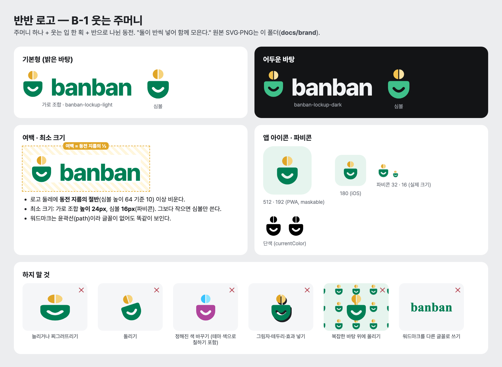
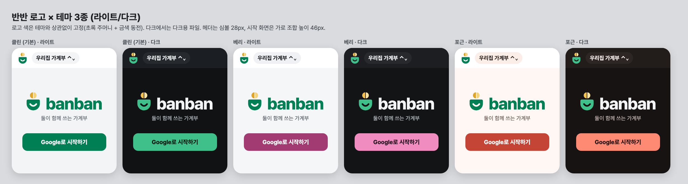

## 반반 로고 (B-1 웃는 주머니) — 에셋과 사용 규칙

BANB-22에서 7회 탐색 끝에 확정(2026-11-06, 클라이언트 결정). 탐색 기록은 `docs/design-explore/`.

**뜻**: 주머니 하나 + 웃는 입 한 획 + 반으로 나뉜 동전 — "둘이 반씩 넣어 함께 모은다."

### 파일

| 쓰는 곳 | 파일 |
|---|---|
| 가로 조합(심볼 + 워드마크) | `banban-lockup-light.svg` / `-dark.svg` / `-mono.svg`, PNG `png/lockup-*-128h.png` |
| 심볼만 | `banban-symbol-light.svg` / `-dark.svg` / `-mono.svg`(`currentColor`), PNG `png/symbol-*-512.png` |
| 워드마크만 | `banban-wordmark-light.svg` / `-dark.svg` / `-mono.svg` |
| 파비콘 | `favicon.svg`(기기 다크 모드에 따라 색이 바뀜), `favicon.ico`(16·32·48), `png/favicon-16.png` · `-32` · `-48` |
| iOS 홈 화면 | `png/apple-touch-icon-180.png` |
| PWA manifest | `png/icon-192.png`, `png/icon-512.png` (둘 다 `purpose: "any maskable"`로 써도 됨 — 심볼이 안전 영역 80% 원 안에 있음), `png/icon-1024.png`(스토어·원본) |
| 앱 아이콘 원본 | `banban-app-icon.svg` (꽉 찬 정사각, 바탕 `#E6F4EE`. 모서리는 OS가 깎는다) |

- 워드마크는 Pretendard ExtraBold(SIL OFL 1.1) 글자를 **윤곽선(path)**으로 바꾼 것이라 글꼴 없이 똑같이 보인다. 자간 −4%.
- 모든 SVG는 도형뿐(외부 글꼴·이미지 없음). 웃는 입은 mask 구멍이라 어떤 바탕에서도 바탕이 비친다.

### 색 (테마와 상관없이 고정)

| 부분 | 라이트 | 다크 |
|---|---|---|
| 주머니 · 워드마크 | `#007F55` (클린 테마 포인트 색과 같음) | 주머니 `#3FC08A`, 워드마크 `#F2F4F6` |
| 동전 왼쪽 / 오른쪽 | `#E0A526` / `#F6D27A` | `#F2C14E` / `#FBE3A4` |
| 앱 아이콘 바탕 | `#E6F4EE` | (같음) |

**결정 기록 (디자인)**: 로고 색은 테마(베리·포근)를 따라 바꾸지 않는다. 브랜드는 하나로 기억되어야 하고, 초록 + 금색은 세 테마 위에서 모두 충돌 없이 보인다(`png/brand-themes.png`). 단색이 필요하면 `-mono.svg`를 `color`로 칠한다.

### 규칙

- **여백**: 로고 둘레에 동전 지름의 절반(심볼 높이 64 기준 10) 이상.
- **최소 크기**: 가로 조합 높이 24px, 심볼 16px. 24px보다 작은 자리엔 심볼만.
- **앱 안에서**: 시작·로그인 화면은 가로 조합(높이 40–48px). 헤더는 가계부 전환 알약이 주인공이라 로고를 넣지 않는 것을 기본으로 하고, 넣는다면 심볼 24–28px만(가로 조합 금지).
- **하지 말 것**: 늘리기·찌그러뜨리기, 돌리기, 색 바꾸기(테마 색으로 칠하기 포함), 그림자·테두리·효과, 복잡한 사진·패턴 위, 워드마크를 다른 글꼴로 다시 쓰기, 동전을 떼거나 주머니 안에 넣기, 눈 추가하기.

### 확인

- 헤드리스 Chrome으로 SVG를 각 크기 그대로 렌더링해 PNG를 만들고 눈으로 확인했다(16px 포함).
- 상표 검색(KIPRIS)은 하지 않았다. 출시 전에 도형 상표 검색을 한 번 하길 권한다.
